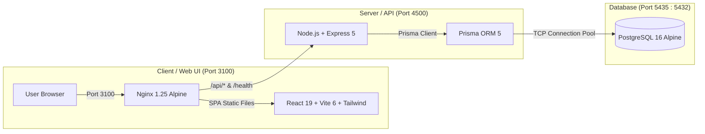

# 🚀 DutyLedger — Attendance & Payroll Management System

A production-grade, containerized **Attendance, Leave, and Payroll Management System** developed for **Lucent Polysystem Pvt. Ltd.**  
Built with **Node.js (Express 5)**, **React 19 (Vite 6 + Tailwind CSS)**, and **PostgreSQL 16 with Prisma ORM**, completely orchestrated with **Docker Compose**, reverse-proxied via **Nginx Alpine**, and automated with **GitHub Actions CI/CD**.

---

## 🏗️ Architecture Overview



- **Frontend**: Vite 6, React 19, Tailwind CSS 4, Redux Toolkit, Material-UI, Framer Motion, Recharts.
- **Backend**: Node.js, Express 5, Prisma ORM, JWT, Bcrypt, Multer, Nodemailer.
- **ORM & Database**: Prisma ORM with PostgreSQL 16 Alpine.
- **Containerization**: Multi-stage Docker build for client (Node -> Nginx Alpine), optimized Node Alpine for backend, and PostgreSQL service with automated healthchecks.
- **CI/CD**: GitHub Actions workflow verifying Prisma schema validation, database migrations against test PostgreSQL, frontend production build, and Docker image validation.

---

## ⚡ Quick Start with Docker (Recommended)

You can launch the entire stack with zero manual configuration. Sensible defaults are included directly in `docker-compose.yml`:

```bash
docker compose up --build
```

Once started:
- **Client Application**: [http://localhost:3100](http://localhost:3100)
- **Express Backend API**: [http://localhost:4500](http://localhost:4500)
- **Health Check Endpoint**: [http://localhost:4500/health](http://localhost:4500/health)

> **Note**: On container startup, the backend automatically runs `prisma db push` to synchronize the PostgreSQL database schema and seeds initial dummy credentials.

To stop the containers:
```bash
docker compose down
```

To wipe the database volume and start fresh:
```bash
docker compose down -v
```

---

## 🔑 Default Login Credentials

Initial accounts are automatically seeded into the database:

| Role | User ID | Email | Password | Access Level |
| :--- | :--- | :--- | :--- | :--- |
| **HR / Admin** | `ADMIN001` | `admin@example.com` | `admin123` | Full HR Dashboard, Payroll, Employee Management |
| **Employee** | `EMP001` | `employee@example.com` | `employee123` | Employee Portal, Attendance Punch, Salary Slips |

---

## 💻 Local Development (Without Docker)

### 1. Prerequisites
- Node.js >= 20.x
- PostgreSQL instance running on port 5432 (or 5435)

### 2. Configure Environment Files
Copy the sample `.env.example` file:

```bash
cp .env.example .env
cp .env.example Backend/.env
```

### 3. Setup and Run the Backend

```bash
cd Backend
npm install

# Push database schema & generate Prisma client
npx prisma db push

# Seed baseline users & roles
npm run seed

# Start server in watch mode
npm run dev
```
The backend will start on [http://localhost:4500](http://localhost:4500).

### 4. Setup and Run the Frontend

```bash
cd ../Frontend
npm install

# Start Vite dev server
npm run dev
```
The client will start on [http://localhost:5173](http://localhost:5173). Requests to the API default to `http://localhost:4500`.

---

## 📁 Project Directory Structure

```text
dutyledger/
├── .github/
│   └── workflows/
│       └── ci-cd.yml             # GitHub Actions CI/CD pipeline
├── Backend/
│   ├── config/
│   │   └── db.js                 # Prisma client instance & DB health ping
│   ├── modules/
│   │   ├── announcements/        # Company announcements
│   │   ├── attendanceCopy/       # Daily punch in/out & attendance tracking
│   │   ├── auth/                 # JWT Authentication & password management
│   │   ├── calendar/             # Holiday calendar management
│   │   ├── cloudinary/           # Profile photo uploads
│   │   ├── contactwithHR/        # Employee queries & HR tickets
│   │   ├── mail/                 # Nodemailer email alerts
│   │   ├── payroll/              # Salary structures & payroll generation
│   │   ├── rbac/                 # Role-Based Access Control
│   │   └── user/                 # Employee records & profile updates
│   ├── prisma/
│   │   ├── schema.prisma         # PostgreSQL Prisma schema
│   │   └── seed.js               # Initial seed script
│   ├── Dockerfile                # Production Node Alpine Dockerfile
│   └── package.json
├── Frontend/
│   ├── src/
│   │   ├── Components/           # Reusable UI components & Sidebars
│   │   ├── Pages/                # HR and Employee page views
│   │   ├── Redux/                # Redux Toolkit global store & slices
│   │   └── utils/                # API helpers and salary slip PDF generation
│   ├── Dockerfile                # Multi-stage build: Node -> Nginx Alpine
│   ├── nginx.conf                # Nginx reverse proxy & SPA routing config
│   └── package.json
├── .dockerignore
├── .env.example                  # Root environment configuration
├── docker-compose.yml            # Multi-container PostgreSQL + Backend + Nginx stack
└── README.md
```

---

## 📜 License
Developed for **Lucent Polysystem Pvt. Ltd.** All rights reserved.
